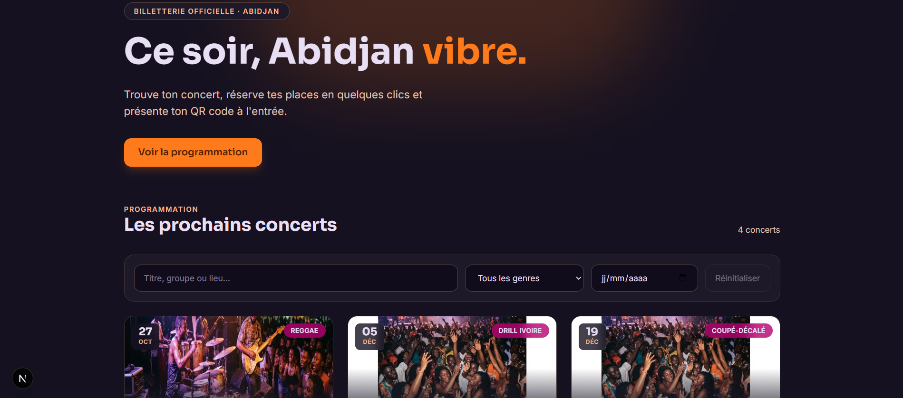

# My Show Time — Billetterie de concerts à Abidjan

Application web de billetterie pour les concerts et festivals d'Abidjan : les spectateurs découvrent la programmation, réservent leurs places et présentent un **QR code** à l'entrée ; les administrateurs pilotent les concerts, les utilisateurs et le contrôle des billets.

Ce dépôt contient le **front-end** (Next.js). Il consomme l'API REST **NestJS + MongoDB** : [`<lien-du-dépôt-backend>`](https://github.com/toumaniaboubacarbamba/-my_show_time).

> 🔗 Démo : _à venir_ · 📚 Documentation de l'API (Swagger) : `<url-de-l-api>/docs`

<!-- Capture principale : l'accueil -->


---

## Fonctionnalités

### Visiteur
- Programmation des concerts avec **recherche** (titre, groupe, lieu), filtre par **genre** et par **date**, **pagination**
- Filtres conservés dans l'URL (liens partageables, bouton Retour fonctionnel)
- Fiche concert : date, lieu, jauge de places restantes, prix
- Page publique de **vérification de billet** (`/billet/<référence>`)

### Utilisateur connecté
- Inscription / connexion (JWT), retour automatique sur la page demandée après connexion
- **Réservation** de 1 à 10 places avec calcul du total en FCFA
- **Mes réservations** : onglets À venir / Passées / Annulées, **QR code** de chaque billet (téléchargeable), annulation en deux étapes
- **Favoris** : suivre un groupe, le retrouver dans « Mes favoris »
- **Notifications** : cloche avec compteur de non lues, marquage individuel ou global
- **Profil** : changement d'email et de mot de passe (mot de passe actuel requis)

### Administrateur
- **Tableau de bord** : revenus, billets vendus, réservations, taux d'annulation, activité quotidienne (7 / 30 / 90 jours), concerts les plus réservés, revenus par genre
- **Gestion des concerts** : création, modification, suppression, recherche, pagination
- **Gestion des utilisateurs** : création, changement de rôle, modification, suppression, filtres (garde-fous sur son propre compte)
- **Contrôle des billets à l'entrée** : saisie ou collage de la référence (ou du lien du QR code), résultat valide / annulé / introuvable, historique de session, alerte de doublon, scan caméra quand la page est en HTTPS

---

## Stack technique

| Domaine | Technologies |
|---|---|
| Framework | **Next.js 16** (App Router, Turbopack, Cache Components) |
| Langage | **TypeScript** |
| Interface | **React 19**, **Tailwind CSS 4** (design system « Abidjan Nightpulse » en tokens) |
| Polices | Sora, Inter (`next/font`) |
| API | REST **NestJS**, **MongoDB**, authentification **JWT** |
| Maquettes | Google Stitch |

### Choix d'architecture
- **Client API typé** (`src/lib/api.ts`) : un seul point d'entrée pour les appels, gestion du token JWT et des messages d'erreur de l'API.
- **Contexte d'authentification** (`useAuth`) : utilisateur, connexion, inscription, déconnexion, rechargement du profil.
- **QR code protégé** : l'image est récupérée avec `fetch` + en-tête `Authorization`, puis affichée via une URL locale (`blob:`), car un `` ne peut pas envoyer de token.
- **Chargements sans `setState` dans les effets** : chaque résultat est rangé avec la clé de la requête qui l'a produit, et l'état de chargement en est déduit (conforme aux règles `react-hooks` de React 19).
- **Zone admin** protégée côté interface par un garde de rôle ; la vraie protection reste côté API (guards NestJS).

---

## Structure du projet

```
src/
├── app/                      # Routes (App Router)
│   ├── page.tsx              # Accueil + programmation
│   ├── concerts/[id]/        # Fiche concert + réservation
│   ├── billet/[reference]/   # Vérification publique d'un billet
│   ├── reservations/  favoris/  profil/
│   ├── (auth)/login  register
│   └── admin/                # Tableau de bord, concerts, utilisateurs, contrôle
├── components/
│   ├── layout/  concerts/  bookings/  favorites/  profile/  auth/  admin/
└── lib/                      # api.ts, auth-context.tsx, types.ts, format.ts, reference.ts
```

---

## Installation

### Prérequis
- Node.js 20+
- L'API My Show Time lancée en local (voir le dépôt backend) — par défaut sur le port `3000`

### Lancement

```bash
git clone https://github.com/<ton-compte>/<dépôt-front>.git
cd my-show-time-web
npm install
```

Crée un fichier `.env.local` à la racine :

```env
NEXT_PUBLIC_API_URL=http://localhost:3000
```

Puis :

```bash
npm run dev      # http://localhost:3001 (port défini dans package.json)
npm run lint
npm run build
```

> Le script `dev` utilise `next dev -p 3001` pour laisser le port 3000 à l'API.

### Côté API : CORS
L'API doit autoriser l'origine du front, par exemple dans `main.ts` :

```ts
app.enableCors({ origin: ["http://localhost:3001"] });
```

### Tester depuis un téléphone (même Wi-Fi)
1. Récupérer l'adresse du PC (`ipconfig` sous Windows) : par exemple `192.168.1.129`.
2. Dans `.env.local` : `NEXT_PUBLIC_API_URL=http://192.168.1.129:3000` (sans espace, port de l'**API**).
3. Dans `next.config.ts` : `allowedDevOrigins: ["192.168.1.129"]`.
4. Côté API : écouter sur `0.0.0.0` et autoriser l'origine du front (CORS).
5. Autoriser les ports 3000 et 3001 dans le pare-feu, puis ouvrir `http://192.168.1.129:3001` sur le téléphone.

---

## Comptes et données de test

| Rôle | Comment l'obtenir |
|---|---|
| Utilisateur | Inscription via `/register` |
| Administrateur | _À compléter : script de seed, ou passage du rôle à `admin` dans la base / via l'endpoint `PATCH /admin/users/{id}/role`_ |

---

## Captures d'écran

À placer dans `docs/screenshots/` :

| Fichier | Page |
|---|---|
| `accueil.png` | Accueil et programmation |
| `fiche-concert.png` | Fiche concert avec bloc de réservation |
| `reservations.png` | Mes réservations avec un QR code affiché |
| `notifications.png` | Cloche de notifications ouverte |
| `admin-dashboard.png` | Tableau de bord admin |
| `admin-concerts.png` | Gestion des concerts |
| `admin-controle.png` | Contrôle d'un billet valide |
| `mobile.png` | Accueil sur téléphone |

---

## Limites connues et pistes d'amélioration

- **Validation à l'entrée** : le contrôle de billet est en lecture seule ; il manque une route `check-in` côté API (date d'entrée enregistrée, refus du second passage) pour empêcher vraiment la réutilisation d'un billet.
- **Paiement** : les réservations ne passent par aucun paiement (Wave / Orange Money prévus dans les maquettes).
- **Images** : les concerts n'ont pas d'affiche en base ; des visuels génériques sont utilisés selon le genre.
- **Scan caméra** : nécessite HTTPS et un navigateur compatible (`BarcodeDetector`).
- **Tests automatisés** : tests de composants et de bout en bout à ajouter.
- **Déploiement** : restreindre le CORS aux domaines réels, définir `NEXT_PUBLIC_API_URL` sur l'URL publique de l'API.

---

## Auteur

**Aboubacar Toumani Bamba** — développeur full-stack, Abidjan
[GitHub](https://github.com/toumaniaboubacarbamba) · [LinkedIn](https://github.com/toumaniaboubacarbamba)